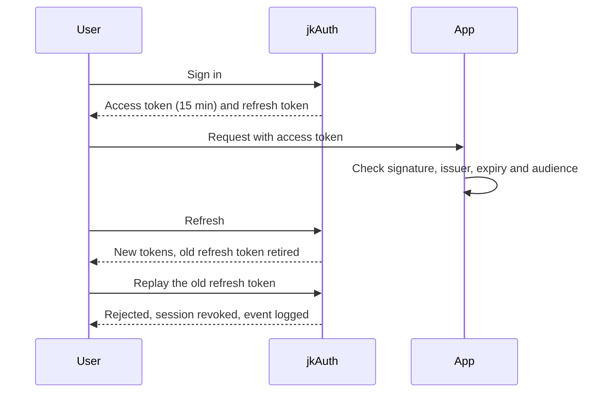
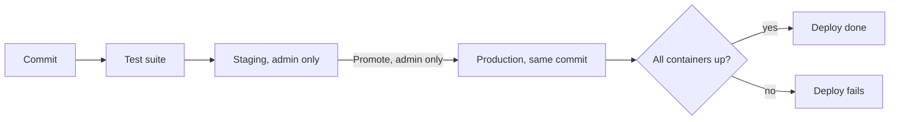
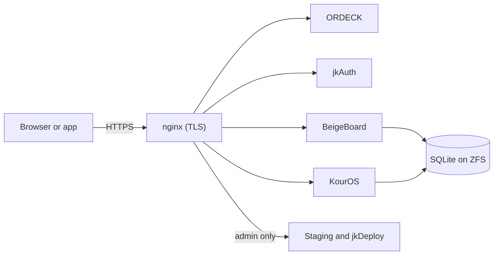

# jkOS

A self-hosted suite of web apps running on TrueNAS SCALE. It has single sign-on, an audit log, and
separate staging and production environments.

| App | Purpose |
|---|---|
| ORDECK | Portal |
| jkAuth | Single sign-on and app directory |
| BeigeBoard | Tasks, goals and calendar |
| KourOS | Music and audiobooks |
| jkDeploy | Deploy console |

Built by [Jag Kondakalla](https://jaaggruthkondakalla.com) as a portfolio project for IT audit roles.
Each security control is enforced in code and covered by a test. All 22 controls are listed in
[CONTROLS.md](Documentation/CONTROLS.md), with the code and test for each.

## 1. Single sign-on and sessions

- jkAuth signs tokens with RS256. The private key stays in jkAuth. Other apps verify tokens with the
  public key.
- Each token lists the apps it is valid for, and an app rejects a token meant for another app.
  Backends refuse to start in production if this check isn't configured.
- Access tokens expire after 15 minutes.
- Refresh tokens rotate on every use. Reusing an old one revokes the whole session.
- Sessions have a maximum lifetime, even if they keep refreshing.
- Revoked sessions are kept with a reason, not deleted.
- Database triggers block a sign-in code from being used twice, and a session from moving to
  another client.



Test: [security.mjs](apps/jkauth/test/security.mjs) starts the real server and tries token replay,
expired sessions, and a token issued for the wrong app. Code: [tokens.js](apps/jkauth/src/tokens.js),
[db.js](apps/jkauth/src/db.js).

## 2. Audit log

jkAuth records 40 event types in an `auth_events` table, including sign-ins, failed sign-ins,
lockouts, password changes, token reuse and denied service requests.

- The client IP comes from nginx only, so a client can't fake it. jkAuth won't start if that setting
  changes.
- Users can see their own events. Admins can see everyone's.
- If writing an event fails, the sign-in still works.

Example rows (IPs are from reserved documentation ranges):

```
created_at                type                  user  ip            meta
2026-11-03T21:14:02.118Z  login_fail            3     203.0.113.24  {"email":"…"}
2026-11-03T21:14:09.502Z  login_locked          3     203.0.113.24
2026-11-03T21:20:41.007Z  refresh_reuse         5     198.51.100.7  {"family":"…"}
2026-11-03T21:22:15.664Z  service_token_denied        192.0.2.10    {"client_id":"…"}
```

Tests: [security.mjs](apps/jkauth/test/security.mjs) checks that events are written.
[multiuser.mjs](apps/jkauth/test/multiuser.mjs) checks that users can't read each other's events.

## 3. Deployments



- Staging is admin-only. nginx checks with jkAuth before serving any staging page.
- Staging and production use separate sign-ins. A staging login doesn't work in production.
- Deploying requires an admin account.
- Production is reset to the exact commit that ran on staging. There is no merge step, and the
  server can't push code.
- A deploy fails if any container isn't running or reports itself unhealthy. The nginx config is
  tested before nginx restarts.

Output from a failed deploy:

```
=== Verifying containers ===
  ok  jkos-auth (running, health=healthy)
  ok  bb-app (running, health=healthy)
[ERROR] container kouros-app is 'restarting' (expected running)
[ERROR] one or more containers failed to come up — deploy NOT healthy
```

Code: [lib-deploy.sh](infra/scripts/lib-deploy.sh), [jkos-deploy/main.py](jkos-deploy/main.py),
[nginx config generator](infra/nginx/gen-nginx-weave.mjs).

## 4. Access policy

All permissions live in one table in [policy.js](apps/jkauth/src/policy.js). It lists each action
(such as `widgets:publish` or `events:read:all`) and the roles allowed to do it: guest, user, admin.
Routes check an action, never a role directly. [test/policy.mjs](test/policy.mjs) fails if a route
checks a role on its own.

## 5. Controls matrix

[CONTROLS.md](Documentation/CONTROLS.md) lists 22 controls. Each row has the risk, the code that
enforces it, the test that proves it and the audit event it leaves. The file ends with a list of
known gaps.

The test suite checks this file. Every file it cites must exist, every test it cites must run, and
every event it cites must be one jkAuth actually writes. This is one of 36 conformance checks in the
suite.

## Architecture



Everything runs in Docker behind one nginx server. Each app keeps its own SQLite database on the NAS.

## Run it

Requires Node 20 or later and pnpm.

```bash
pnpm install
pnpm test:contracts     # full test suite, about two minutes
```

More: [Architecture](Documentation/ARCHITECTURE.md) · [Operations](Documentation/OPERATIONS.md) ·
[Open work](Documentation/TODO.md)

MIT licensed. See [LICENSE](LICENSE).
