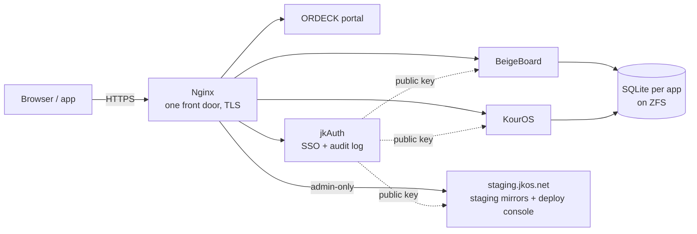
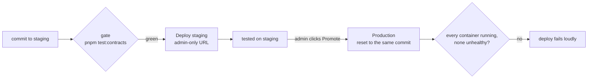

# jkOS

**A self-hosted suite of apps, built as an access-control and audit exercise.**

jkOS runs on a home server (TrueNAS SCALE, ZFS, Docker) behind one Nginx front door with TLS.
It is a set of apps:
- **ORDECK**, the portal.
- **jkAuth**, single sign-on and the app directory.
- **BeigeBoard**, for tasks, goals and calendars.
- **KourOS**, for music and audiobooks.
- A deploy console.

Production and staging are kept separate. Every app trusts one identity service and nothing else.

It is also the portfolio piece of [Jag Kondakalla](https://jaaggruthkondakalla.com), who is moving
into IT audit. The rule it is built on: **a control that exists in configuration but not in code
is the worst kind of defect.** So each control below is enforced in code, proved by a test that
runs on every commit, and leaves a record. The full list of 21 is in
[CONTROLS.md](Documentation/CONTROLS.md), which the build checks against the code.



---

## 1 · Sign-in that can't be replayed

Single sign-on with RS256-signed tokens. The private key never leaves jkAuth. Every other service
verifies with the public key, and accepts a token only if it was issued **for that service**.
One cookie reaches every `*.jkos.net` host, so without that audience check a token minted for one
app could be spent at all of them. Every Node backend
[refuses to start in production](packages/weave/src/server/auth.js) without an audience to check.

Sessions are built to survive theft:
- **Short-lived access:** the access token expires after 15 minutes.
- **Rotation:** the refresh token rotates on every use. Replaying an old one revokes every token
  from that sign-in.
- **A hard ceiling:** a session has an absolute lifetime no amount of refreshing extends.
- **Evidence kept:** a revoked session is kept as a record with its reason, not deleted.
- **Rules in the database:** two rules sit in the database itself, below the application. A
  native sign-in code is redeemed once, and a session never changes its client.

```mermaid
sequenceDiagram
  participant U as User
  participant A as jkAuth
  participant X as Any app
  U->>A: sign in (+ second factor)
  A-->>U: access token (15 min, aud = apps this role may use) + refresh token
  U->>X: request with token
  X->>X: verify signature, issuer, expiry, and aud includes this app
  U->>A: refresh
  A-->>U: new pair; the old refresh token is now spent
  Note over U,A: replaying a spent token → whole sign-in revoked, refresh_reuse logged
```

**Proof:** [apps/jkauth/test/security.mjs](apps/jkauth/test/security.mjs) boots the real server and
attacks it over HTTP. It replays rotated tokens, outlives the absolute cap, and forges a token that is
valid in every way except its audience. Code: [tokens.js](apps/jkauth/src/tokens.js),
[db.js](apps/jkauth/src/db.js).

## 2 · Every decision leaves a record

jkAuth writes each authentication decision to an `auth_events` table. That covers 40 kinds of
event: sign-ins and failures, lockouts, second-factor failures, password changes, token reuse,
refused service credentials, and admin publishes.
- **Trusted IP only:** the client IP comes from exactly one trusted proxy hop (Nginx), so a
  client can't write its own into the log. The service [refuses to boot](apps/jkauth/src/app.js)
  if that setting drifts.
- **Records stay readable:** an over-long record is clipped and stays valid JSON.
- **Logging never blocks:** a failure to log never fails a sign-in.
- **Scoped reading:** users read their own trail. Only an admin reads everyone's.

Example rows (documentation IPs):

```
created_at                type                 user  ip            meta
2026-11-03T21:14:02.118Z  login_fail           3     203.0.113.24  {"email":"…"}
2026-11-03T21:14:09.502Z  login_locked         3     203.0.113.24
2026-11-03T21:20:41.007Z  refresh_reuse        5     198.51.100.7  {"family":"…"}
2026-11-03T21:22:15.664Z  service_token_denied       192.0.2.10    {"client_id":"…"}
```

**Proof:** [security.mjs](apps/jkauth/test/security.mjs) asserts the events are written.
[multiuser.mjs](apps/jkauth/test/multiuser.mjs) asserts one user can't read another's.

## 3 · Production only gets what staging tested



- **Admin-only staging:** every staging URL sits behind Nginx, which asks jkAuth whether the
  visitor is an admin before serving anything.
- **Separate sign-ins:** production and staging use different token issuers and cookie names, so a
  staging session grants nothing in production.
- **Admin-only deploys:** deploy and promote need an admin session.
- **The exact commit:** promotion resets production to the commit staging ran. There is no merge
  step, and the server holds no credential to push code.
- **A deploy only counts when it runs:** a deploy is "done" only when every container is up. Nginx
  config is validated before Nginx is restarted.

What a deploy with a crash-looping container prints:

```
=== Verifying containers ===
  ok  jkos-auth (running, health=healthy)
  ok  bb-app (running, health=healthy)
[ERROR] container kouros-app is 'restarting' (expected running)
[ERROR] one or more containers failed to come up — deploy NOT healthy
```

Code: [lib-deploy.sh](infra/scripts/lib-deploy.sh), [jkos-deploy/main.py](jkos-deploy/main.py),
[the Nginx generator](infra/nginx/gen-nginx-weave.mjs).

## 4 · Least privilege as one table

Authorization lives in one readable table, [policy.js](apps/jkauth/src/policy.js). A route names
an action, such as `widgets:publish`, `staging:enter`, `events:read:all` or `account:manage`, and
the table says which roles (guest, user, admin) hold it. "What can a guest do?" is answered by
reading, not by searching. The shared guest account is deliberately excluded from account changes,
so one visitor can't lock out the rest. [test/policy.mjs](test/policy.mjs) fails the build if any
route compares roles on its own.

## 5 · A controls matrix the build checks

[CONTROLS.md](Documentation/CONTROLS.md) lists every control. Each row gives the risk it addresses,
the code that enforces it, the test that proves it and the audit event it leaves. A known-gaps
section names what is not yet covered. The build parses it on every run. Every cited file must
exist, every cited test must actually run, and every cited event must be one jkAuth writes. If a
row stops being true, the build goes red. The same idea runs through the suite: 36 conformance
checks re-derive invariants from source rather than trusting a document.

---

## Run it

Needs Node ≥ 20 and pnpm.

```bash
pnpm install
pnpm test:contracts     # the whole gate (about two minutes)
```

Architecture: [Documentation/ARCHITECTURE.md](Documentation/ARCHITECTURE.md) ·
Operations: [Documentation/OPERATIONS.md](Documentation/OPERATIONS.md) ·
Open work: [Documentation/TODO.md](Documentation/TODO.md)

MIT licensed. See [LICENSE](LICENSE).
